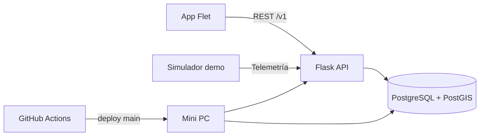

# Zentryx

Plataforma de movilidad para mejorar la experiencia del transporte público, comenzando con **Mexibús Línea 2**.

Zentryx es un monorepo: la app móvil, la API, la base de datos, los contratos y los prototipos viven en un solo repositorio, con límites claros entre componentes.

## Arquitectura



La API compartida de desarrollo se publica únicamente en la red Tailscale del equipo. `unit-demo-01` permite probar el flujo completo sin GPS físico.

## Estructura

```text
app/          Cliente Flet
backend/      API Flask, navegación, telemetría y simulador
database/     Esquema PostgreSQL/PostGIS y migraciones
contracts/    Contratos entre componentes
docs/         Arquitectura, desarrollo y operación
prototypes/   Firmware, modelo 3D y juego
scripts/      Herramientas operativas y smoke tests
.github/      CI/CD y plantillas de colaboración
```

## Primer setup

Desde la raíz:

```bash
python3 -m venv .venv
source .venv/bin/activate
python -m pip install --upgrade pip
python -m pip install -r requirements-dev.txt
```

En PyCharm selecciona como intérprete:

```text
<repo>/.venv/bin/python
```

## Comandos frecuentes

```bash
make setup          # crea .venv e instala dependencias
make verify         # compila + ejecuta tests
make app            # abre la app contra la API compartida
make server-up      # API + PostgreSQL + simulador
make server-status  # estado de contenedores
make smoke          # prueba end-to-end contra la API compartida
```

## Flujo del equipo

1. `Fetch/Pull` antes de empezar.
2. Trabaja en PyCharm.
3. Ejecuta `make verify` antes de subir cambios importantes.
4. Commit y push.
5. Todo push a `main` ejecuta CI.
6. Si CI pasa, la mini PC hace auto-deploy y ejecuta el smoke test.

Para cambios grandes se recomienda una rama y Pull Request. `main` debe mantenerse desplegable.

## Documentación

- [Arquitectura](docs/architecture/overview.md)
- [Flujo de desarrollo](docs/development/workflow.md)
- [Despliegue](docs/operations/deployment.md)
- [ADR de estructura](docs/adr/0001-repository-structure.md)
- [Backend](backend/README.md)
- [App](app/README.md)
- [Base de datos](database/README.md)
- [Contrato API v1](contracts/api_v1.md)

## Seguridad

Nunca subas `.env`, tokens, contraseñas, claves SSH o credenciales de Tailscale. Consulta [SECURITY.md](SECURITY.md).
