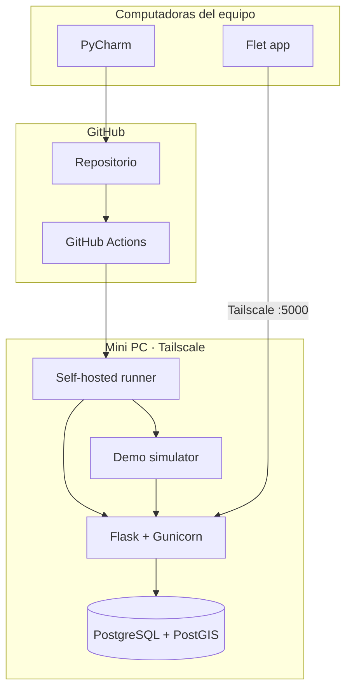

# Arquitectura del sistema

## Componentes

### App

Cliente Flet orientado a móvil. Consume `/v1` y representa mapa, estaciones, unidad, ETA y alertas.

### Backend

API Flask con cuatro grupos de rutas: health/readiness, rutas/estaciones, vehículos/navegación y telemetría/alertas/incidentes.

La lógica de navegación vive fuera de las rutas HTTP para poder probarse de forma aislada.

### PostgreSQL + PostGIS

Fuente de verdad para rutas, estaciones, unidades, telemetría, alertas, conductores e incidentes. La geometría se mantiene en PostGIS.

### Simulador de desarrollo

`backend/dev_simulator.py` crea una unidad demo y publica telemetría usando la misma API que usaría un dispositivo real. Permite desarrollar sin GPS físico.

### Contratos

`contracts/` define la interfaz estable entre app, backend y futuros dispositivos.

## Topología compartida

## Principios

1. `main` debe ser desplegable.
2. CI valida antes de desplegar.
3. La base persistente nunca se elimina durante un deploy normal.
4. Secretos permanecen fuera de Git.
5. Producto y prototipos se mantienen separados.
6. En modo servidor, la API es la autoridad para navegación y ETA.
